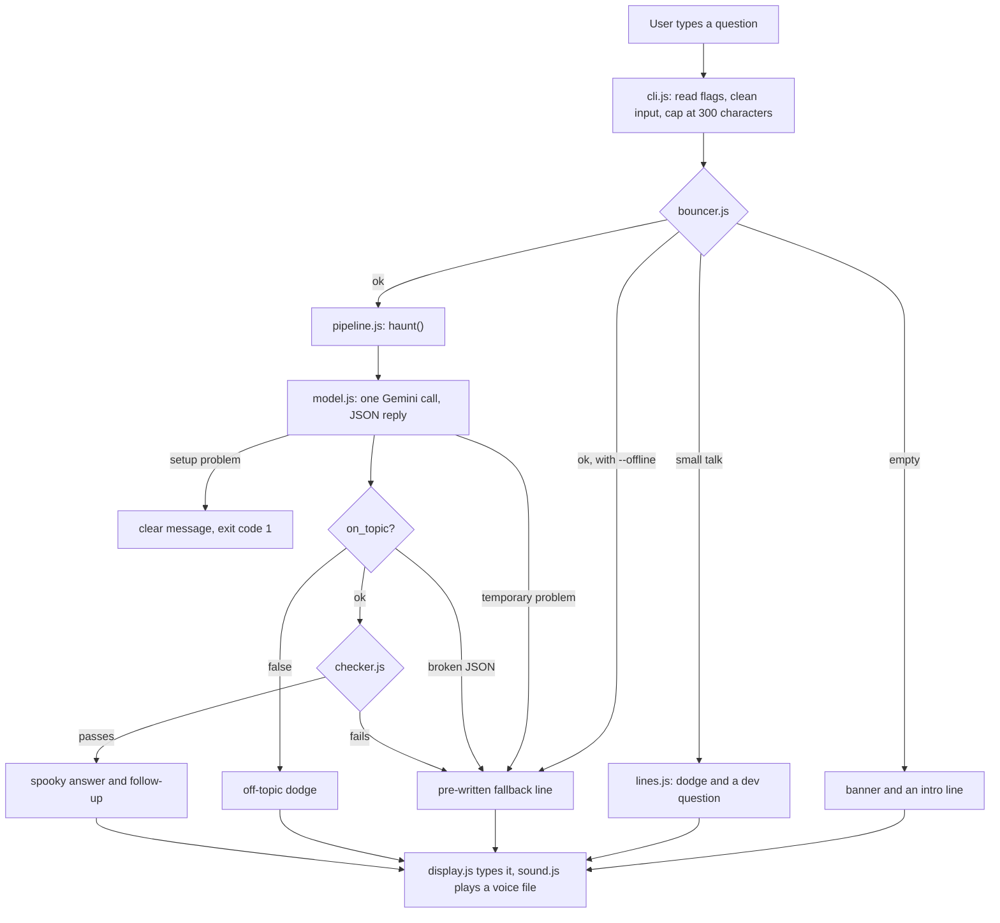

# Architecture

HauntedShell is a small Node.js command-line program. A question goes in, passes through a chain of small steps, and a checked, spooky answer comes out. Every step can fail safely.

## Flow



## What each file does

| File | Job |
|---|---|
| `bin/hauntedshell.js` | The file the terminal runs. Three lines. |
| `src/cli.js` | Reads flags, cleans input, picks a path, prints. Last safety net for unexpected errors. |
| `src/bouncer.js` | Says `empty`, `small_talk` or `ok`. Plain code. |
| `src/pipeline.js` | Calls the model, parses the reply, runs the checker, chooses a fallback. |
| `src/model.js` | The only file that talks to Gemini. Timeout, one retry, named errors. |
| `src/prompts.js` | The ghost's rules, and the wrapper that marks the question as data. |
| `src/checker.js` | Inspects every AI reply. |
| `src/lines.js` | Every pre-written ghost line, each with a sound name. |
| `src/display.js` | Colors, banner, typing effect. |
| `src/sound.js` | Plays voice files. Never throws. |
| `src/config.js` | Settings and loading `.env`. |
| `src/debug.js` | Prints details only when `HAUNTEDSHELL_DEBUG=1`. |

## The reply from Gemini

One call returns JSON like this:

```json
{
  "on_topic": true,
  "topic": "concurrency",
  "spooky_answer": "...",
  "key_terms": ["threads", "shared data"],
  "follow_up": "Who guards the lock when no one is watching?"
}
```

`haunt()` turns it into `{ source, topic, text, follow_up }`. `source` is `ai`, `dodge`, `fallback` or `offline`. The `topic` field is saved for a future treasure-hunt feature.

The rules go in a separate system instruction. The user's question is wrapped in `<question>` tags, and any closing tag typed by the user is removed.

## What the checker verifies

1. `on_topic` is exactly `true`, the fields exist, and `key_terms` is a list.
2. The answer is at most 700 characters.
3. The follow-up ends with `?` and contains exactly one question mark.
4. No banned words or phrases. "kill" alone is allowed; "kill you" is not.
5. At least half of the key terms still appear in the answer.
6. Leftover markdown (backticks, asterisks) is removed from a passing reply.

It returns a list of problems, not just yes or no, so debug mode can show every reason.

## When things go wrong

| What happens | What the user sees | Exit code |
|---|---|---|
| No `GEMINI_API_KEY` | Clear message about the key | 1 |
| Key refused (400, 401, 403) | Clear message, no retry | 1 |
| Model name not found (404) | Clear message, no retry | 1 |
| No internet, timeout, 429, 5xx | One retry after 1 second, then a ghost fallback line | 0 |
| Empty or broken reply, failed checker | A ghost fallback line | 0 |
| Unknown flag | Message and usage text | 1 |
| A real bug | "The ghost tripped over something unexpected", details in debug mode | 1 |

## Settings

| Setting | Meaning |
|---|---|
| `GEMINI_API_KEY` | API key. Lives in `.env`, never committed. |
| `HAUNTEDSHELL_MODEL` | Model name, so a rename needs no code change. |
| `HAUNTEDSHELL_DEBUG=1` | Timings and real error reasons, on the error channel. |

Fixed in `config.js`: question cap 300 characters, timeout 20 seconds, retry delay 1 second. The typing effect is capped at about 4 seconds.

## Security notes

- The key is read from `.env` or the environment, and sent in a header, not in the web address.
- `config.js` finds `.env` from its own location, so the command works from any folder.
- The model has no tools, no file access and no secrets in its prompt. The worst a manipulated reply can do is produce text, which the checker inspects.
- Prompt injection is reduced (separate rules, question as data) but not removed.

## How it is tested

- Unit tests for the bouncer, checker and sound helper.
- Pipeline tests replace `fetch` with a fake Gemini: good replies, off-topic, broken JSON, wrong shape, checker rejection, network failure with one retry, missing key, wrong key.
- Command-line tests run the real program as a child process and check its output and exit code. None touch the network.

## Changing it later

- **A different model:** edit `model.js` and the model setting.
- **Two-step AI (facts, then style):** change `haunt()` in `pipeline.js`. Nothing else knows how many calls it makes.
- **Treasure hunt:** the `topic` field and the separate pipeline are the hooks.